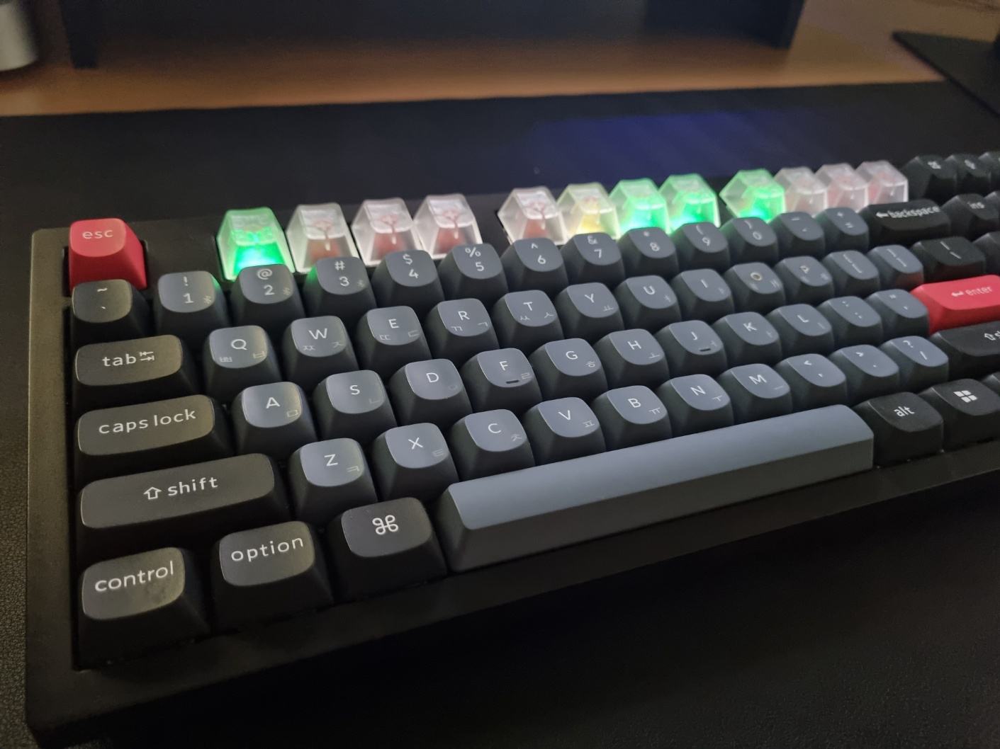
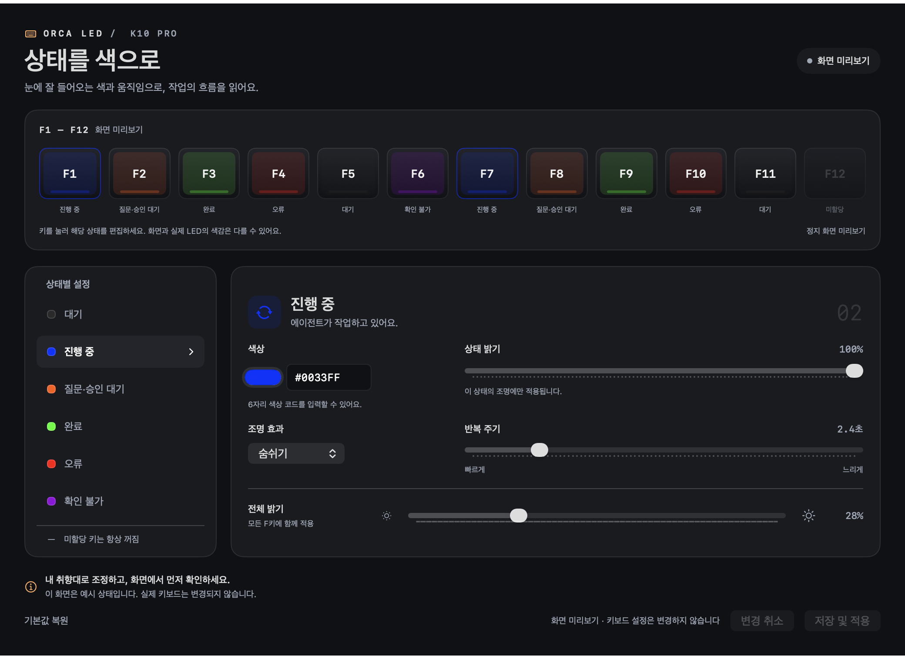

# Orca × Keychron LED

**에이전트 상태는 키보드 조명으로 보고, 작업 화면은 F키 한 번으로 엽니다.**

Orca에서 여러 AI 코딩 에이전트를 동시에 돌리다 보면 어느 작업이 끝났고 어느 작업이 내 답을 기다리는지 계속 확인해야 합니다. 이 프로젝트는 Keychron K10 Pro RGB의 **F1–F12를 Orca 작업공간 12개와 연결**합니다. 각 F키 조명이 해당 작업의 상태를 보여 주고, 그 키를 누르면 바로 그 작업공간으로 이동합니다.



*실제 사용 모습입니다. F키마다 해당 작업공간의 상태 색이 표시됩니다.*



*설정 앱의 예시 미리보기입니다. 실제 작업 정보는 포함하지 않습니다.*

> **실험 단계의 개인 프로젝트입니다.** 대상은 **Keychron K10 Pro ANSI RGB · macOS · Orca** 조합 하나입니다(검증한 Orca 버전: 1.4.223, 1.4.241). 키보드에 커스텀 펌웨어를 설치해야 합니다. Orca 또는 Keychron의 공식 제품이나 공식 연동이 아닙니다.

[설치·펌웨어](docs/public/INSTALL.md) · [사용법·문제 해결](docs/public/USAGE.md) · [상태 판단 기준](docs/public/STATUS.md) · [통신 프로토콜](docs/protocol.md) · [공개본 만들기](docs/public/PUBLISHING.md)

## 주요 기능

- **상태 조명** — F1–F12가 Orca 사이드바의 처음 12개 작업공간 상태(진행 중·질문 대기·완료·오류 등)를 색과 효과로 표시합니다.
- **F키 이동** — 다른 앱을 쓰다가 F키를 누르면 Orca의 해당 작업공간이 열립니다. 이미 보고 있는 작업의 F키를 다시 누르면 Orca 창이 최소화됩니다.
- **앱 하나로 시작** — `Orca LED.app`을 열면 Orca를 연동 모드로 열고, 준비되는 대로 연동을 자동으로 시작합니다.
- **색상·효과 설정** — 내장된 설정 앱에서 상태별 색상·밝기·효과·주기를 바꾸고 미리 볼 수 있습니다. 펌웨어를 다시 설치하지 않아도 됩니다.
- **Bluetooth 무선 동작** — 평소에는 케이블 없이 BT로 연결해 사용합니다.
- **안전한 복귀** — 연동이 끊기면 15초 뒤 F키가, 30초 뒤 조명이 원래대로 돌아갑니다.

## 동작 방식

```text
Orca 작업공간 순서와 에이전트 상태
             ↓
  Orca LED.app (macOS 메뉴 막대)  ←  색상·효과 설정 앱
             ↕ Bluetooth
 키보드 펌웨어: F1 · F2 · … · F12 조명
             ↓ 키 누르기
       해당 Orca 작업공간
```

- Orca 앱 파일은 수정하지 않습니다. Orca의 로컬 런타임 소켓과 로컬 디버깅 포트(`127.0.0.1:19347`)로 실행 중인 Orca에 연결합니다.
- 작업 순서는 Orca에서 **Cmd+숫자**가 선택하는 사이드바 순서를 따릅니다.
- Fn·보조 키 조합과 작업이 없는 F키는 원래 동작을 유지합니다. 길게 눌러도 이동은 한 번만 일어납니다.

## 상태 표시

| 상태 | 기본 색상 | 기본 효과 |
|---|---|---|
| 진행 중 | 파랑 | 숨쉬기 |
| 질문·승인 대기 | 주황 | 두 번 점멸 |
| 완료 | 초록 | 계속 켜짐 |
| 오류 | 빨강 | 세 번 점멸 |
| 대기 | 어두운 흰색 | 계속 켜짐 |
| 확인 불가 | 핑크·보라 | 느린 점멸 |
| 작업 없음 | 꺼짐 | — |

**완료**는 Orca가 관측한 명시적인 종료 신호(예: 에이전트 응답 턴 종료)를 뜻합니다. 작업이 성공했다는 보장은 아닙니다. 신호가 없으면 추측하지 않고 **확인 불가**로 표시합니다. 자세한 기준은 [상태 문서](docs/public/STATUS.md)에 있습니다.

## 요구 사항

| 항목 | 조건 |
|---|---|
| 키보드 | Keychron K10 Pro **ANSI RGB** (USB `3434:02A0`) + 이 프로젝트의 펌웨어 |
| Mac | Apple Silicon, macOS 14 Sonoma 이상 |
| Orca | `/Applications/Orca.app`에 설치. 검증 버전(`orca_led/orca_compat.json`, 현재 **1.4.223·1.4.241**)은 전체 기능, 그 밖의 버전은 구조 확인을 통과하면 LED 상태만 표시(**미검증**, F키 이동 꺼짐) |
| Python | 3.9 이상. macOS 기본 Python(Xcode Command Line Tools)으로 충분합니다 |
| 케이블 | 펌웨어 설치 때만 USB **데이터** 케이블 필요 |

ISO/JIS 배열, 흰색 백라이트 모델, K10·K10 Max는 확인하지 않았습니다. Orca가 업데이트되면 내부 인터페이스가 바뀌어 동작하지 않을 수 있습니다.

## 설치

### 1. 앱 내려받기

[Releases](../../releases/latest)에서 `Orca-LED-<버전>-macos-arm64.zip`을 내려받아 압축을 풀고, `Orca LED.app`을 **응용 프로그램** 폴더로 옮깁니다. 색상 설정 앱도 이 안에 들어 있어서 앱은 하나만 설치하면 됩니다.

**처음 열 때 보안 경고:** 이 앱은 Apple 공증을 받지 않았습니다. 처음 열면 "확인되지 않은 개발자" 경고가 뜹니다.

- **시스템 설정 → 개인정보 보호 및 보안** 아래쪽에서 **그래도 열기**를 누릅니다.
- 또는 터미널에서 다음을 한 번 실행합니다.

  ```sh
  xattr -dr com.apple.quarantine "/Applications/Orca LED.app"
  ```

**Python:** 연동 코드는 macOS 기본 Python 3로 실행합니다. Command Line Tools가 없으면 처음 실행할 때 설치 창이 뜹니다. 터미널에서 `xcode-select --install`로 미리 설치해도 됩니다.

설정과 상태 기록은 `~/Library/Application Support/Orca LED/`에 저장됩니다.

<details>
<summary>소스에서 직접 빌드하기</summary>

Xcode Command Line Tools(Swift 6)가 필요합니다.

```sh
git clone <this-repo> && cd orca-keychron-led
./scripts/build-release.sh     # dist/Orca LED.app 과 배포용 zip
```

개발할 때는 `./scripts/build-native.sh`와 `./scripts/build-settings.sh`로 `build/`에 앱을 만듭니다. 저장소 안에서 실행한 앱은 저장소의 `orca_led/`와 `runtime/` 폴더를 사용합니다.

</details>

### 2. 키보드 펌웨어 설치 (처음 한 번)

**앱만으로는 설치할 수 없는 유일한 단계입니다.** 저장소를 내려받아 진행하며, 펌웨어 빌드에는 libusb 개발 파일과 pkg-config가 필요합니다. **반드시 [설치 문서](docs/public/INSTALL.md)를 먼저 끝까지 읽어 주세요.** 순서는 다음과 같습니다.

1. [Keychron Launcher](https://launcher.keychron.com)에서 키보드의 **공식 펌웨어를 최신 버전으로 업데이트**합니다. 백업·설치 도구는 VIA 12만 지원하며, 오래된 공식 펌웨어(VIA 10)에서는 백업이 멈춥니다.
2. **Cable 모드**에서 키맵·매크로를 백업합니다.
3. 물리 Reset으로 **DFU** 모드에 들어가 원본 플래시를 두 번 읽어 보관합니다.
4. 펌웨어를 쓰고 다시 읽어 비교합니다.
5. 일반 USB 장치로 돌아온 것을 확인하고 USB 테마 지원을 확인합니다.

쓰기를 시작한 뒤에는 확인이 끝날 때까지 케이블을 빼지 마세요. 설치하면 VIA 키맵과 조명이 기본값으로 초기화되니, 필요한 키는 VIA에서 공식 정의 파일로 다시 지정합니다.


```sh
./scripts/build-firmware.sh --prepare   # 고정된 소스·도구로 빌드만 함, 설치하지 않음
```

### 3. macOS 권한

**시스템 설정 → 개인정보 보호 및 보안**에서 **손쉬운 사용**과 **입력 모니터링** 두 곳 모두 `Orca LED`를 허용합니다. 메뉴 막대 **⌨ LED → 필요한 macOS 권한 요청…**으로 요청 창을 띄울 수 있습니다.

앱을 새 버전으로 바꾸면 macOS가 기존 허용을 인정하지 않을 수 있습니다. 이때는 목록에서 Orca LED를 지운 뒤 다시 추가하세요.

## 사용법

1. 키보드를 **BT** 모드로 Mac에 연결합니다.
2. **`Orca LED.app`을 엽니다.** 이것으로 끝입니다.
   - Orca가 꺼져 있으면 연동 모드로 열고, 준비되면 연동을 자동으로 시작합니다.
   - Orca가 평소 방식으로 켜져 있으면 **"Orca를 연동 모드로 다시 열까요?"** 확인창이 뜹니다. **다시 열기**를 누르면 Cmd+Q와 같은 방식으로 종료한 뒤 다시 엽니다. 강제 종료하지 않으니 저장하지 않은 작업은 먼저 정리하세요.
3. 조명이 동기화되면 F키를 사용합니다. 전체 상태 동기화는 약 7초, 한 칸 변경은 약 3초 걸립니다.

메뉴 막대의 **⌨ LED** 메뉴에서 현재 F키별 상태 확인, 연동 중지, 밝기 조절, 연결·권한 진단을 할 수 있습니다.

### 색상과 효과 바꾸기

메뉴 막대 **⌨ LED → 색상과 효과 설정…**으로 설정 앱을 엽니다. 상태를 고르고 색상(`#RRGGBB`)·밝기·효과·주기를 바꾼 뒤 **저장 및 적용**을 누릅니다. 효과는 계속 켜짐·숨쉬기·점멸·두 번 점멸·세 번 점멸·끄기를 지원합니다.

- 처음 전체 설정 전송은 약 2분, 이후에는 바뀐 상태만 전송합니다.
- Bluetooth에는 수신 확인 응답이 없습니다. "전송 완료"는 Mac 쪽 전송 완료를 뜻하므로 실제 조명도 확인하세요.
- 설정은 Mac에 저장되고, 키보드는 연동 중에만 적용합니다(키보드 RAM).

## 자주 겪는 문제

| 증상 | 확인할 것 |
|---|---|
| 연동이 시작되지 않음 | 메뉴 **실행 기록 열기**에서 원인 확인. `Grant Input Monitoring…`이면 권한, `cdp_unavailable`이면 Orca가 일반 모드로 켜진 것 |
| Orca를 아이콘으로 켰음 | `Orca LED.app`을 다시 열고 확인창에서 **다시 열기** |
| 핑크·보라색이 깜빡임 | 연결 오류가 아니라 에이전트 상태 신호가 없다는 뜻일 수 있음 → [상태 기준](docs/public/STATUS.md) |
| Codex 상태가 누락되거나 다른 칸에 표시됨 | 새 Orca 터미널에서 `codex --no-daemon`으로 시작 → [자세히](docs/public/USAGE.md#codex-응답이-끝났는데-핑크색이거나-다른-칸이-바뀌어요) |
| omp 작업공간이 핑크·보라로 깜빡임 | Orca가 omp 훅을 관측했는지, 30분 넘게 새 훅이 없는 긴 도구 실행인지, Orca 재시작 전에 끝난 턴인지, 같은 작업공간에 상태 없는 탭이 열려 있는지 확인 → [자세히](docs/public/USAGE.md#핑크보라색이-계속-깜빡여요) |
| 설정을 저장했는데 조명이 그대로임 | BT 연결, 연동 실행 여부, USB 테마 지원 확인 여부 점검 후 같은 설정을 다시 저장 |
| 키보드 전원을 껐다 켬 | BT 재연결 후 재전송을 기다리고, 원래 색이면 연동 중지 → 시작 |
| 메뉴는 "Bluetooth 전송 중"인데 불이 꺼져 있고 F키가 원래 F1–F12로 동작 | 키보드가 신호를 받지 못한 상태. 연동 중지 → 시작, 그래도 안 되면 키보드 전원을 껐다 켜고 BT 재연결. 계속되면 Cable 모드에서 **USB 펌웨어 확인…** |
| Command·Option 등 일반 키가 이상함 | 먼저 **연동 중지**. VIA에서 공식 정의 파일로 키 확인 → [설치 문서](docs/public/INSTALL.md#mac-키-코드-호환성) |
| 백업이 `Unreviewed VIA protocol 10`으로 멈춤 | Keychron Launcher에서 공식 펌웨어 최신화 후 다시 백업 → [자세히](docs/public/USAGE.md#백업이-unreviewed-via-protocol-10으로-멈춰요) |
| 메뉴에 `Orca 1.4.x · 미검증` 표시, F키 이동이 안 됨 | Orca 업데이트 후 아직 검증하지 않은 버전. `./scripts/verify-orca-version.py`로 확인 → [자세히](docs/public/INSTALL.md#orca-업데이트-후-버전-검증) |
| `Orca 화면 구조가 바뀌어 읽을 수 없음` | Orca 업데이트로 내부 구조가 달라짐. 연동 코드 업데이트가 필요 |

더 많은 경우는 [사용법·문제 해결](docs/public/USAGE.md)에 있습니다.

## 원래 펌웨어로 되돌리기

**자신의 기기에서 백업하고 검증한 원본**으로만 복원합니다. 절차는 [설치 문서](docs/public/INSTALL.md)에 있습니다. 공장 초기화나 VIA 초기화는 펌웨어 복원이 아닙니다. 모든 고장 상태에서 복구가 보장되지는 않습니다.

## 개발

```sh
# 호스트 테스트: 키보드에 쓰지 않음
python3 -m unittest discover -s tests -v
python3 -m unittest discover -s tests/firmware -p 'test_*.py' -v
./tests/firmware/run.sh

# 공개할 소스만 별도 폴더로 내보내기
python3 scripts/export-public.py --output ../orca-keychron-led-github
```

| 경로 | 역할 |
|---|---|
| `orca_led/` | Orca 상태 읽기, 작업공간 이동, Bluetooth 전송, 테마 관리 (Python, 표준 라이브러리만 사용). `orca_compat.json`은 검증한 Orca 버전 목록 |
| `native/` | 메뉴 막대 앱과 HID·권한 처리(Swift), `native/settings/` 설정 앱(SwiftUI) |
| `firmware/src/` | 키보드 쪽 패킷 해석, F키 입력, RGB 표시 (QMK 기반 C) |
| `firmware/upstream.lock.json` | 펌웨어 소스·도구의 고정 버전과 체크섬 |
| `scripts/` | 앱·배포 zip·펌웨어 빌드, Orca 연동 모드 실행, Orca 버전 검증, 키맵 백업·복원, 공개본 내보내기 |
| `tests/` | 호스트·펌웨어·복원 절차 자동 테스트 |

## 라이선스

이 프로젝트의 소스는 **GPL-2.0-or-later**로 배포합니다. Keychron/QMK 기반 펌웨어와 외부 구성요소는 각자의 저작권과 라이선스를 따릅니다. [LICENSE](LICENSE)와 [THIRD_PARTY_NOTICES.md](THIRD_PARTY_NOTICES.md)를 참고하세요.
