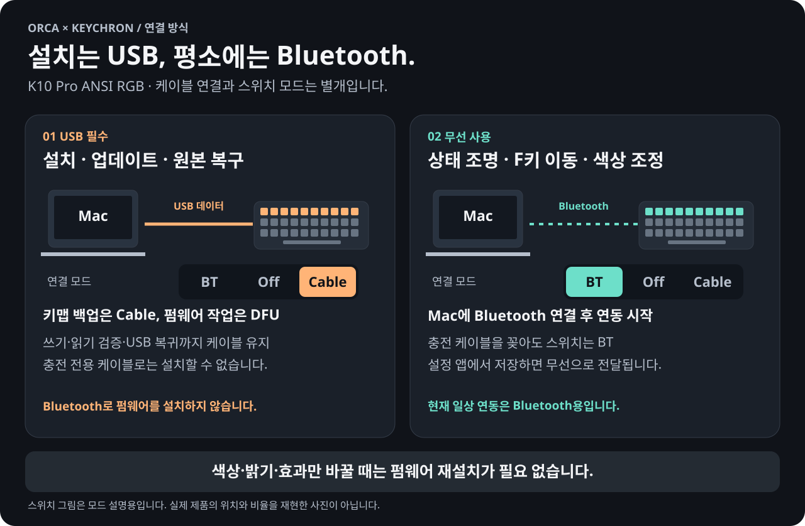
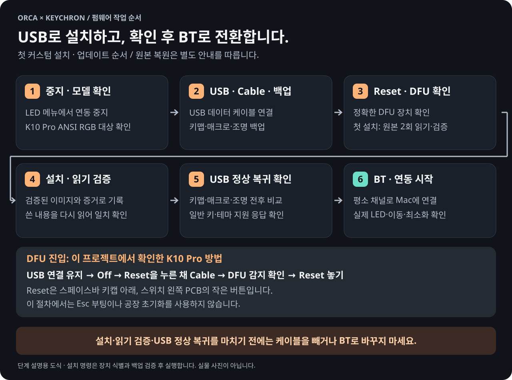

# 설치와 개발 빌드

이 문서는 공개 소스용 안내입니다. 다른 사람의 백업·장치 번호·설치 기록을 자신의 키보드에 적용하면 안 됩니다. 이 저장소는 원본 펌웨어 백업이나 바로 설치할 실행 파일을 배포하지 않습니다.

## USB와 Bluetooth의 역할

**펌웨어를 설치·업데이트·원본 복원할 때는 USB 데이터 케이블이 반드시 필요합니다.** Bluetooth로 펌웨어를 설치하는 기능은 없습니다. 충전만 가능한 케이블은 사용할 수 없습니다.



- **Cable 모드:** 키맵 백업, 설치된 펌웨어의 지원 여부 확인, USB 시험을 합니다.
- **DFU 모드:** 물리 Reset으로 진입하는 업데이트 모드입니다. 펌웨어를 쓰고 다시 읽어 검증합니다. 일반 키보드로 보이지 않고 키 입력도 잠시 동작하지 않습니다.
- **BT 모드:** 에이전트 조명·F키 이동·저장한 색상과 효과를 사용합니다. USB 케이블은 빼도 되고 충전용으로 연결해도 됩니다.

케이블을 꽂기만 하거나 BT 스위치를 그대로 둔 채 설치를 시작하면 안 됩니다. 현재 일상 연동 프로그램은 **Bluetooth 전용**이며, Cable 모드로 일상 연동을 계속하는 기능은 없습니다. 색상·밝기·효과를 설정 앱에서 바꿀 때는 **BT에서 저장하면 되며 펌웨어를 다시 설치하지 않습니다.**

## 1. 앱 빌드

현재 설정 앱 빌드는 **Apple Silicon Mac · macOS 14 Sonoma 이상 · Python 3.10 이상 · Swift 6을 지원하는 Xcode Command Line Tools**가 필요합니다. Intel Mac과 이전 macOS는 이 빌드 스크립트의 지원 대상으로 검증하지 않았습니다. 저장소 최상위에서 실행합니다.

```sh
./scripts/build-native.sh
./scripts/build-settings.sh
open "build/Orca LED.app"
open "build/Orca LED Settings.app"
```

빌드된 앱은 프로젝트 폴더의 `build/` 안에서 사용하세요. 앱은 인접한 프로젝트 소스와 설정 파일을 사용하므로 앱 하나만 임의 위치로 옮기지 않습니다. 메뉴 앱은 실행 즉시 키보드를 제어하지 않습니다.

**시스템 설정 → 개인정보 보호 및 보안 → 손쉬운 사용 / 입력 모니터링**에서 `Orca LED.app`을 허용합니다. 로컬 빌드는 기본적으로 임시(ad-hoc) 서명을 사용합니다. 실행 파일이 바뀌면 macOS가 별도 앱으로 판단할 수 있어 기존 권한 항목을 제거하고 새 앱을 등록해야 할 수 있습니다. 설정 앱을 별도로 빌드하면 기존 연동 앱의 서명은 바뀌지 않습니다.

다시 빌드할 때마다 권한을 다시 허용하지 않으려면, 처음 한 번 `./scripts/create-signing-identity.sh`를 실행해 로그인 키체인에 자체 서명 인증서 `Orca LED Local Signing`을 만듭니다(신뢰 설정 때 로그인 암호를 묻습니다). 이후 빌드 스크립트는 이 인증서로 서명하므로 권한이 유지됩니다. 이 인증서는 이 Mac에서만 유효하며 Apple 공증을 대신하지 않습니다. 다른 서명 ID를 쓰려면 `ORCA_LED_SIGN_IDENTITY`를 지정합니다.

설정 앱에는 손쉬운 사용·입력 모니터링 권한이 필요하지 않습니다. 프로젝트가 바탕화면에 있으면 macOS가 설정 파일을 읽고 저장하기 위한 바탕화면 접근을 요청할 수 있습니다.

## 2. 펌웨어 준비

대상은 **K10 Pro ANSI RGB**, `keychron/k10_pro/ansi/rgb:orca_led`입니다. 모델 이름·USB 식별자만으로 MCU와 PCB 버전까지 확인됐다고 판단하지 마세요. 다른 키보드용 설치 절차가 아닙니다.

자동 빌드 준비는 Apple Silicon macOS용입니다. libusb 개발 파일과 pkg-config를 미리 준비한 뒤 실행합니다.

```sh
./scripts/build-firmware.sh --prepare
```

이 명령은 `firmware/upstream.lock.json`의 고정 URL·체크섬을 사용해 `firmware/vendor/`에 도구를 내려받고, 패치를 적용하고, 검사를 거쳐 이미지를 빌드합니다. **키보드에는 설치하지 않습니다.** 재빌드는 `./scripts/build-firmware.sh`로 수행합니다.

결과의 `k10_pro_ansi_rgb_orca_led.bin`은 커스텀 이미지입니다. `k10_pro_ansi_rgb_upstream_via_rebuilt.bin`은 같은 고정 소스에서 재빌드한 VIA 이미지이며 **사용자 기기에서 읽은 원본 백업이 아닙니다.**

새 색상·효과 설정은 `THEME 0x16`을 처리하는 펌웨어가 필요합니다. 기존 기본 조명 펌웨어에서 설정 앱만 실행해도 새 색상이 적용된다고 가정하면 안 됩니다. 개발 검증 기기에서는 새 펌웨어의 실제 설치·전체 쓰기 내용 읽기 비교·USB 테마 지원 응답과 청록색 표시를 확인했습니다. 기존 키맵·매크로·레이아웃·조명 설정도 유지됐습니다. 이 결과가 다른 기기의 백업과 호환성 확인을 대신하지는 않습니다.

## 3. 백업과 설치 범위 확인

먼저 USB 데이터 케이블과 Cable 모드에서 키맵·매크로·조명을 백업합니다.

```sh
python3 scripts/backup-via.py --help
python3 firmware/flash.py --help
python3 scripts/restore-via.py --help
```

`backup-via.py`는 같은 내용을 두 번 읽고 비교하는 도구입니다. 백업 파일과 해시는 개인적으로 보관하고 GitHub에 올리지 않습니다. 펌웨어 교체 전에는 키맵 백업 외에 자신의 장치에서 읽은 원본 플래시와 복구 절차도 확보해야 합니다.

`flash.py`는 기본적으로 설치 계획만 출력합니다. 실행 시에도 정확한 기기 식별, 검증한 백업, 지원하는 메모리 범위, 원본 일치 조건을 요구하며 실제 쓴 내용도 다시 읽어 비교합니다. 다른 사람의 장치 번호·하드웨어 근거를 복사하거나 검증 조건을 우회하지 마세요. DFU 재진입과 물리 Reset 버튼 조작은 사용자 단계입니다. 모델별 물리 절차는 [Keychron 공식 안내](https://www.keychron.com/pages/firmware-and-json-files-of-the-keychron-qmk-k-pro-and-k-max-series-keyboards)를 확인합니다.

### 첫 설치와 업데이트 순서



1. **LED 연동 중지.** 다른 키보드 설정 프로그램도 닫고, USB 데이터 케이블을 연결한 뒤 **Cable** 모드에서 일반 키 입력과 장치 인식을 확인합니다.
2. **현재 설정 백업과 원본 백업 유무 확인.** Cable 모드에서 자신의 키맵·매크로·레이아웃·조명을 두 번 읽어 비교합니다. 검증한 원본 펌웨어 백업이 이미 있는지도 확인합니다. 첫 설치의 원본 플래시 읽기는 아래 DFU 단계에서 수행합니다. 키맵 JSON만으로 펌웨어 전체를 복구할 수는 없습니다. 업데이트 때는 현재 설정과 직전 성공 설치 기록도 보존합니다.
3. **이미지와 대상 확인.** 모델·PCB/MCU·쓰기 범위·펌웨어 해시·키 코드 체계가 해당 기기와 맞는지 확인합니다. 도구가 거부하는 조건을 강제로 해제하지 않습니다.
4. **DFU 진입과 원본 확보.** 아래 물리 Reset 절차로 진입하고, 도구에서 올바른 업데이트 장치인지 확인합니다. 첫 설치라면 이 단계에서 자신의 원본 펌웨어와 설정 영역을 두 번 읽어 일치를 검증하고 보관합니다. 검증된 원본 백업이 준비되기 전에는 쓰지 않습니다.
5. **쓰기와 읽기 검증.** 검증된 절차로 설치한 뒤 쓴 내용을 다시 읽어 이미지와 비교합니다. **쓰기 시작부터 읽기 검증과 정상 USB 복귀가 끝날 때까지 케이블을 빼거나 전원을 전환하지 않습니다.** 백업과 설치 기록은 성공 뒤에도 보관합니다.
6. **일반 USB 상태 재확인.** Cable 모드의 키보드로 돌아온 뒤 Command·Option 등 일반 키와 기존 설정을 확인합니다. 키맵·매크로·레이아웃·조명은 설치 전후 읽기 결과를 비교합니다. **읽기 결과뿐 아니라 키 코드의 의미도 일치하고 일반 키 동작이 정상이라면** 복원 쓰기는 필요 없습니다.
7. **커스텀 펌웨어의 테마 지원 확인 후 BT 전환.** [USB 테마 확인](#5-색상과-효과)을 마치고 BT 모드로 연결한 뒤 LED 연동을 시작합니다. 이때부터 케이블은 선택 사항입니다. **이 단계는 커스텀 펌웨어 설치·업데이트용이며, 원본 펌웨어 복원에는 적용하지 않습니다.**

이 흐름은 필요한 확인 순서입니다. 장치 번호나 개인 원본을 생략한 범용 쓰기 명령을 제공하지 않습니다. `flash.py`의 계획과 검증 결과를 해당 기기의 근거와 함께 검토해야 합니다.

### Reset 버튼과 DFU 진입

Keychron의 [공식 펌웨어 안내](https://www.keychron.com/pages/firmware-and-json-files-of-the-keychron-qmk-k-pro-and-k-max-series-keyboards)는 **Cable/Wired 모드에서 준비 → 스페이스바 키캡 아래 스위치 왼쪽 PCB의 Reset 버튼 확인 → Reset을 누른 채 USB 재연결 → DFU 인식 후 Reset 놓기**를 설명합니다. **케이블 재연결은 DFU 진입을 위한 설치 전 단계**입니다. 쓰기가 시작된 뒤에는 재연결하지 않습니다. 공식 페이지의 공통 예시 사진은 모든 K10 Pro의 실물 사진을 뜻하지 않으므로 실제 기기의 버튼을 확인하세요.

이 프로젝트에서 검증한 K10 Pro는 **USB 연결 유지 → 스위치 Off → Reset 누른 상태에서 Cable → DFU 확인 후 Reset 놓기**로도 진입했습니다. 키보드가 다르거나 이 방법으로 인식되지 않으면 모델별 공식 안내를 따르세요. Reset을 찾지 못한 상태에서 다른 버튼·핀을 대신 누르지 않습니다.

DFU를 확인하려고 키맵 초기화나 공장 초기화를 먼저 할 필요는 없습니다. Esc를 사용하는 Bootmagic이나 VIA 초기화는 설정을 바꿀 수 있어 원본 백업을 위한 물리 Reset 절차와 구분합니다.

### Mac 키 코드 호환성

VIA 프로토콜 버전이 같아도 일부 사용자 정의 키 코드의 의미가 다를 수 있습니다. 초기 검증에서 Command·Option·Mission Control·Launchpad의 6개 코드 순서 차이를 발견했습니다. **기존 키맵의 바이트가 똑같이 복원됐다는 것만으로 기능까지 복원됐다고 판단하면 안 됩니다.**

`official-to-pinned-618127a` 프로필은 검증한 원본 키맵에만 적용됩니다. 이미 6개 키가 보정된 키맵에는 `repaired-pinned-618127a` 프로필로 기존 코드를 유지하며, 변환을 두 번 적용하지 않습니다. 두 프로필 모두 검증한 키맵 해시와 호환 이미지에만 적용됩니다. 범용 자동 변환기가 아니며, 다른 키맵·펌웨어에서 실패하면 그 조건을 제거하는 대신 해당 조합을 검증해야 합니다. 펌웨어 전체를 실제 원본으로 돌릴 때는 원본의 키 코드 체계를 그대로 복원해야 합니다.

현재 고정된 커스텀 키 코드 체계로 VIA를 편집할 때는 `firmware/recovery/k10_pro_ansi_rgb_orca_led_618127a_via.json`을 사용합니다. 원본 Keychron JSON은 비교용으로 별도 보존합니다. 새 소스에서 키 코드 체계를 바꿨다면 정의 파일도 다시 확인해야 합니다.

## 4. Orca 연결

현재 지원 버전은 **Orca 1.4.223**이며 설치 위치는 `/Applications/Orca.app`입니다. `Orca LED.app`을 열면 Orca를 내부 로컬 연결 모드로 엽니다. Orca가 이미 일반 모드로 켜져 있으면 확인을 받은 뒤 정상 종료하고 다시 엽니다. 메뉴 앱 없이 Orca만 이 모드로 열려면 Orca를 직접 종료한 뒤 다음 스크립트를 실행합니다.

```sh
./scripts/start-orca-debug.command
```

두 방법 모두 Orca를 강제 종료하거나 설치 파일을 수정하지 않습니다. 연결 주소는 `127.0.0.1:19347`입니다. CDP 디버깅 포트는 토큰 인증이 없으므로 같은 Mac의 다른 프로세스도 접근할 수 있습니다. 연동을 사용하지 않을 때는 Orca를 종료하고 평소 방법으로 다시 열면 됩니다.

키보드를 BT로 연결한 뒤 `Orca LED.app`을 열면 Orca가 준비되는 대로 연동을 자동으로 시작합니다. 메뉴의 **펌웨어 검증 후 시작**으로 다시 시작할 수도 있습니다. 처음 상태 전송이 끝날 때까지 기다리세요. 앱의 중지 메뉴로 연동을 해제할 수 있습니다.

### Codex CLI의 상태 신호가 누락되는 경우

최근 Codex CLI의 공유 백그라운드 서버에서는 훅이 원래 터미널 대신 서버의 실행 환경을 물려받는 동작이 [upstream 이슈 #44902](https://github.com/openai/codex/issues/44902)에 설명되어 있습니다. 이 문서는 클라이언트 환경 전달을 요청하는 개선 제안이며 Orca 문제의 원인을 확정하는 증거는 아닙니다. Orca에서 상태가 누락되거나 다른 칸으로 전달된다면 **새 Orca 터미널 세션**에서 다음과 같이 시작하는 방법을 사용할 수 있습니다.

```sh
codex --no-daemon
```

로컬 Codex CLI 0.160.0의 `codex --help`에서 이 옵션이 실행 중인 공유 서버를 사용하지 않고 시작하는 옵션임을 확인했습니다. 기존 Codex 세션을 자동으로 변경하거나 종료하는 명령은 아닙니다. 실행 중인 작업은 유지하고, 세션 재개가 필요하면 [잠금 확인을 포함한 사용 안내](USAGE.md#codex-응답이-끝났는데-핑크색이거나-다른-칸이-바뀌어요)를 따르세요.

Orca가 실제 Codex `Stop`을 관측한 경우 완료 조명으로 매핑합니다. 여기서 **완료는 응답 턴 종료**이며 작업 결과의 성공 보장이 아닙니다. Codex 0.160.0 기존 대화에서 실제 진행 중·완료 신호와 F11 판정을 확인했습니다. 수정본 재시작 후 물리 LED 확인은 대기 중입니다. 키보드 펌웨어 설치나 USB 케이블 변경으로 해결하는 문제가 아닙니다.

## 5. 색상과 효과

테마 지원 펌웨어를 설치한 뒤에는 USB로 지원 여부를 한 번 확인합니다. 메뉴 앱에서 **연동 중지**를 선택하고 키보드를 USB 데이터 케이블로 연결한 뒤 **Cable** 모드로 바꿉니다. 저장소 최상위에서 새로 빌드한 helper를 지정해 실행합니다.

```sh
python3 -m orca_led --helper "build/Orca LED.app/Contents/MacOS/OrcaLED" verify-theme
```

이 명령은 기기의 테마 지원 응답을 읽고 `runtime/theme-firmware.json`에 확인 결과를 저장합니다. 키맵이나 펌웨어를 쓰지 않습니다. 기존 메뉴의 **USB 펌웨어 확인**만으로는 테마 지원 확인 파일이 만들어지지 않습니다. 확인이 성공하면 BT 모드로 돌아가 연동을 다시 시작합니다. 펌웨어를 교체했을 때도 다시 확인하세요.

`Orca LED Settings.app`에서 진행 중·질문·완료·오류·대기·확인 불가의 색상, 개별 밝기, 효과와 주기를 설정합니다. 전체 밝기도 조정할 수 있습니다. 화면 미리보기는 키보드에 전송하지 않고 확인할 수 있으며, 저장·적용 결과와 실제 전송 상태를 구분해서 봅니다.

키보드의 테마는 RAM에만 저장됩니다. 전원을 껐다 켜면 연동 앱이 로컬 설정을 다시 보내야 합니다. Bluetooth로 전체 테마를 적용할 때는 약 2분을 예상합니다. 새 펌웨어의 USB 표시와 설정 앱에서 저장한 테마의 실제 Bluetooth 표시·F키 이동·최소화를 확인했습니다. 재연결·잠자기·장시간 동작과 모든 키·효과 조합은 추가 실기 검증이 필요합니다.

## 6. 원래 펌웨어로 복원

복원도 **USB 데이터 케이블 + DFU**가 필요하며, 쓰기·읽기 검증·정상 USB 복귀까지 케이블을 유지합니다. 복원에 쓸 원본은 **자신의 동일한 기기에서 두 번 읽고 일치를 검증해 보관한 원본**이어야 합니다. 다른 사람의 원본, 다른 모델 이미지, 소스로 재빌드한 VIA 이미지를 그 원본으로 간주하지 않습니다.

원본 복원의 쓰기·읽기 검증·정상 USB 복귀가 끝나면 일반 키와 자신의 설정을 확인하고 **일반 키보드로 사용합니다.** Cable 또는 BT는 일반 키보드 사용 목적에 맞게 선택할 수 있지만, **USB 커스텀 테마 확인·테마 전송·Orca LED 연동 시작 단계는 수행하지 않습니다.** 원본 펌웨어에는 이 프로젝트의 LED·F키 연동 기능이 없습니다.

공장 초기화, VIA 키맵 초기화, 앱 설정 기본값 복원은 **기존 펌웨어 프로그램을 원본으로 되돌리는 작업이 아닙니다.** 원본 플래시 복원과 이후 키맵·매크로 확인은 별도입니다. 원본 펌웨어로 돌아갈 때는 원래 키 코드 체계를 유지하고 커스텀 펌웨어용 변환을 다시 적용하지 않습니다.

업데이트 후 일반 키보드로 부팅되지 않아도 물리 Reset으로 DFU가 인식된다면, 해당 기기의 검증된 원본과 복구 절차로 복원을 검토할 수 있습니다. 먼저 전원·데이터 케이블·포트·DFU 인식을 확인하세요. DFU 자체가 인식되지 않거나 검증한 원본이 없다면 성공을 보장할 수 없습니다. 강제 지우기나 검증 우회 대신 중단하고 Keychron 지원 또는 하드웨어 점검을 이용합니다.

개인 백업·설치 영수증·원본 읽기 파일은 **정리하거나 공개본을 만들 때도 자동 삭제하지 않습니다.** 이 저장소의 공개 내보내기는 그 자료를 제외할 뿐 원래 폴더에서 삭제하지 않습니다. 설치 전에 별도 보관 위치에도 복사해 두면 복구 준비에 도움이 됩니다.

## 사용 중 문제가 생기면

USB가 보이지 않는 경우, 설정이 저장만 되는 경우, Mac·Orca 재시작, 일반 키 이상 등은 [사용 사례와 문제 해결](USAGE.md)을 참고하세요. 펌웨어를 무작정 다시 설치하기 전에 연결 모드와 연동 상태부터 확인합니다.

## 자동 검사

```sh
python3 -m unittest discover -s tests -v
python3 -m unittest discover -s tests/firmware -p 'test_*.py' -v
./tests/firmware/run.sh
```

자동 검사는 실제 키보드 쓰기 없이 수행합니다. 실제 Bluetooth 표시·F키 입력·절전 동작은 자동 검사와 별도로 확인해야 합니다.
